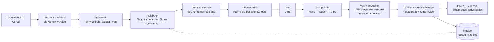

# Bumpless

**Dependabot bumps the version. Bumpless makes it pass.**

**Live demo:** https://bumpless.onrender.com (recorded real runs; the free host sleeps when idle, so the first visit can take about a minute)

Dependabot opens a PR that bumps `pydantic` from 1.x to 2.x, and CI goes red. Someone now has to read the
migration guide, find every affected call, rewrite it, and hope the tests cover it. Bumpless does that work and
shows its evidence:

1. **Research.** Tavily finds the official migration guide and changelog. Nemotron turns them into a rulebook of
   old → new rules, and each rule is **checked against the page it came from**. Rules that the source does not
   support are never applied.
2. **Characterize.** Before touching anything, Bumpless records how the repo's code behaves on the *old* version
   and writes those observations as tests (`tests/_bumpless/`). The migration must keep them green.
3. **Migrate.** Nemotron Ultra plans per file, and Nano makes the search/replace edits. A failed edit escalates
   to Super, then Ultra. Guardrails reject edits that weaken tests or delete repo code from them.
4. **Verify.** Your tests plus the characterization tests run in a Docker sandbox, and failures are diagnosed
   and repaired. **Verified change coverage** reports which changed lines the tests actually execute, and every
   change gets a High / Medium / Low confidence rating with the rule and source URL it came from.
5. **Learn.** A verified rulebook is saved as a recipe. The next repo with the same migration skips research
   (a [benchmarked](#results) cut in cost and time), and a freshness check re-reads the sources once the recipe
   is old.
6. **Talk.** On the PR, `@bumpless revert the change to app/storage.py`, `@bumpless explain …` or
   `@bumpless use model_dump(mode="json") here instead` from an owner or collaborator revises, explains or
   reverts the change, re-runs the tests and replies. Comments from anyone else are ignored without a model call.

Scope: Python + pytest. The engine is generic: there is no package-specific code. The flagship migrations are
pydantic v1 → v2 and openai 0.28 → 1.x, plus a zero-shot SQLAlchemy 1.4 → 2.0 fixture it has no recipe for.

## How it works



## How I use NVIDIA Nemotron + Nebius Token Factory

Every model call goes to Nemotron 3 on **Nebius Token Factory** through its OpenAI-compatible API
(`https://api.tokenfactory.nebius.com/v1/`, the official `openai` SDK). `bumpless doctor` checks the model IDs
against `GET /v1/models` and pings each tier. Each call's cost is computed from its token usage and
`config/pricing.yaml`, shown live in the run view, and capped per run (`MAX_RUN_COST_USD`) and per day for the
hosted demo.

Each task goes to the cheapest tier that does it well (`bumpless/llm/router.py`). A failed edit escalates one
tier at a time. `--routing all-ultra` sends everything to Ultra, for comparison.

| Task | Tier | Calls* | Cost* |
|---|---|---|---|
| Summarize fetched pages into candidate rules | Nano (reasoning off) | 332 | $0.31 |
| Check each rule against its source page | Nano (reasoning off) | 216 | $0.04 |
| Per-file edits | Nano → Super → Ultra | 187 / 50 / 85 | $0.24 / $0.26 / $0.49 |
| Rulebook synthesis | Super | 21 | $0.28 |
| Characterization probe design | Super | 47 | $0.14 |
| Classify `@bumpless` comments, Radar risk | Super | 4 + 6 | < $0.01 |
| Migration plan, final review | Ultra | 41 + 39 | $0.33 + $0.36 |
| Diagnose test failures and repair | Ultra | 135 | $2.99 |

\*All runs on Token Factory while building and benchmarking this project, counted before the credit ran out
on 2026-10-27; later runs on the NVIDIA free tier are not included (46 runs incl. 4 PR-comment sessions and 1 Radar scan; 1,195 calls; $5.60). These include
all-Ultra benchmark runs, which put every task on Ultra. Most of the money goes to Ultra repairing failed
tests, so a better first edit is the cheapest improvement. That is also why tiered routing's savings are smaller
than the per-token prices suggest (see [Results](#results)).

Nemotron findings that shaped the design: with reasoning turned off (`chat_template_kwargs.enable_thinking=false`),
Nano and Super are fast, accurate extractors. That cut the research step from 236 s to 137 s, and doing the same
for edits cut tiered median run time from 286 s to 134 s. A wording change in one prompt stopped both models
answering `NONE` on guide pages that were full of code. Details are in [docs/FEEDBACK.md](docs/FEEDBACK.md).

## How I use Tavily

| What | How | Real count* |
|---|---|---|
| Find the official migration guide and changelog | `search`, `search_depth="advanced"`, `include_raw_content="markdown"` (one call returns the page text, so there is no extract per result), official domains from PyPI metadata | 44 searches |
| Walk the docs section a guide lives in | `map` with `select_paths` scoped to that section, widening one folder at a time when it's small | 28 maps |
| Fetch pages a rule cites that search didn't return | `extract` | 4 |
| **Source verification** | A deterministic check that the page names the API, then Nano confirms the page supports the rule *and* that the old usage really breaks. Only verified rules are applied, and the quote must occur on the page | every rule |
| **Freshness** | A recipe older than `RECIPE_MAX_AGE_DAYS` re-runs search and summarize, and merges new rules | tested on `pydantic_orders` |
| **Error lookup** | During repair, an error with no matching rule is searched (e.g. `"BaseModel.model_copy() got an unexpected keyword argument" pydantic 2.14.1`) | 4 searches |

\*76 calls in total, 53 of them served from the 24-hour SQLite cache. Every Tavily call appears in the run
view with its query and the URLs it returned, and every rule cites the Tavily-fetched URL it came from.

## Nebius Serverless

Not used yet. A Serverless deployment of the web app and a Serverless Jobs sandbox executor were planned. The
executor is a stub (`EXECUTOR=nebius` raises a clear error), and the app has not been deployed to Nebius.

## Features

- **Verified change coverage:** which changed lines the tests actually executed, with a High / Medium / Low
  confidence per change, plus its rule, source URL and the model tier that wrote it.
- **Characterization tests:** behavior recorded on the old version and checked after the migration.
- **PR conversation:** `@bumpless revise / explain / revert`. Owners, members and collaborators only. A revision
  that breaks tests is undone, never pushed.
- **Upgrade Radar:** `bumpless radar <repo>` lists pinned dependencies behind their latest major, with usage
  counts, a Super risk estimate and a cost estimate from past runs. Each row has a Fix button in the UI.
- **Recipes:** verified rulebooks reused across repos, with a freshness check and learned rules.
- **Replays:** real recorded runs streamed with their original timing, so the demo works without live credits.
- **Benchmark harness:** `bumpless bench`, both routing modes, every run stored with its commit.

## Results

Full tables, per-run IDs and every benchmark run: [benchmarks/RESULTS.md](benchmarks/RESULTS.md), generated by
`benchmarks/plot.py` from the stored results. Five fixture repos (3 pydantic v1 → v2, 2 openai 0.28 → 1.x; 37 repo
tests broken by the bump). Benchmark runs reuse the saved recipes, so they measure migration, not research.

On **Nebius Token Factory** (Nemotron 3 Nano / Super / Ultra):

| | Runs | Green | Tests fixed | Total cost (5 repos) | Median time |
|---|---|---|---|---|---|
| All-Ultra | 1 | 5/5 | 37/37 | $0.71 | 120 s |
| Tiered (Nano → Super → Ultra) | 4 | 3, 5, 3, 3 of 5 | 29–37 of 37 | $0.51–$0.68 | 134 s (latest) |

On the **NVIDIA API catalog free tier**, after the Token Factory credit ran out. Nemotron 3 Nano and Super are
listed there but not callable on a trial key, so the Nano and Super tiers ran Nemotron 3.5 Lightning 30B-A3B and
Nemotron 3.5 Super 120B-A12B; Ultra is the same Nemotron 3 Ultra. Costs are Token Factory list prices for the
tokens used, not money spent.

| | Runs | Green | Tests fixed | Total cost (est.) | Median time |
|---|---|---|---|---|---|
| Tiered | 1 | 5/5 | 37/37 | $0.40 | 317 s |
| All-Ultra | 1 | 3/5 (one stopped by a provider timeout) | 27/37 | $0.56 | 475 s |

What this does and doesn't show:

- **Tiered routing is cheaper in every comparison (4–28% on Token Factory, 29% on the NVIDIA free tier).
  Reliability varies between runs:** on Token Factory one tiered run matched all-Ultra (5/5) and the others left 2
  repos partial or failed; on the free tier tiered went 5/5 and all-Ultra 3/5 (one failure was an API timeout,
  the other `openai_moderator`, where every edit attempt failed). The runs used different code versions and
  models (see RESULTS.md), and each mode was run only a few times, so treat these as indicative.
- Median verified change coverage was 100% in every benchmark run.
- Two fixes came out of reading the partial runs. Edits now run with reasoning off: Nano/Super had been using
  their whole 16k-token budget thinking before writing an edit, and this cut tiered median time from 286 s to
  134 s. One-line SEARCH fragments may now grow into multi-line replacements: this was why `openai_moderator`
  failed under tiered routing. With that fix, tiered `openai_moderator` went green on the free tier.
- **Recipe reuse:** the same pydantic migration on a second repo cost $0.077 in 161 s with the recipe, vs $0.083
  in 394 s for the first run, which did the research (runs `48225699b6` → `a18cf7556b`).
- **Zero-shot SQLAlchemy 1.4 → 2.0** (no recipe; `benchmarks/fixtures/sqlalchemy_notes`): 3 runs: green
  (29/29 tests, $0.19, via repair rather than the rulebook), failed (it applied optional "new style" rules that
  broke working code), partial (26/29, $0.42). Those runs led to two fixes. Verification now only applies
  *required* changes. The summarize prompt stopped models answering `NONE` on guide pages full of code. A
  4th run on the fixed code was stopped by the same credit limit. On the NVIDIA free tier: a 5th run failed when
  Super wrote invalid rulebook JSON 3 times (the last retry now goes to Ultra), and a 6th hit the free tier's
  rate limit (the client now waits it out). The 7th went **green**: 6/6 repo tests and 26/26 recorded behaviors,
  100% verified change coverage, 12 of 13 changes citing a verified rule, $0.17 est., 1,170 s (run
  `0adca37e9f`, saved as a replay). It saved a SQLAlchemy recipe, so later SQLAlchemy runs are no longer
  zero-shot.

## Quick start

Requirements: Python 3.11+, [uv](https://docs.astral.sh/uv/), Docker (the sandbox), Node 20+ (only to build the web UI).

```bash
cp .env.example .env          # add NEBIUS_API_KEY and TAVILY_API_KEY
uv sync
docker build -t bumpless-sandbox:1 sandbox/
uv run bumpless doctor        # checks the models are served, pings each tier, shows Tavily usage
uv run bumpless run benchmarks/fixtures/pydantic_app --package pydantic --to ">=2,<3"
```

**No Token Factory credits?** The same Nemotron 3 models are on NVIDIA's API catalog with a free trial key from
[build.nvidia.com](https://build.nvidia.com). Point the OpenAI-compatible settings there (commented block in
`.env.example`): `NEBIUS_BASE_URL=https://integrate.api.nvidia.com/v1` and the `MODEL_*` IDs listed there. Costs
are then Token Factory list-price estimates, not money spent, and benchmark results record which provider ran
them.

Each run writes `bumpless.patch` (a `git am`-able commit) and `report.md` (the PR body) and prints the run ID.

| Command | What it does |
|---|---|
| `bumpless run <path-or-git-url> --package P --to SPEC [--routing tiered\|all-ultra] [--out-dir D]` | Full migration |
| `bumpless serve` | Web UI + API on :8000 (build the UI first: `cd frontend && npm ci && npm run build`) |
| `bumpless bench benchmarks/repos.yaml --routing tiered` | Benchmark every repo in the file; results go to `benchmarks/results/` |
| `bumpless radar <path-or-git-url>` | Upgrade backlog: pinned deps behind their latest major, usage, risk, a cost estimate from past runs |
| `bumpless comment <checkout> --body-file … --association … --base …` | Handle an `@bumpless` PR comment (used by the GitHub Action) |
| `bumpless recipes list` | Saved recipes with reuse stats |
| `bumpless record <run_id>` | Save a finished run as a replay (`demo/recordings/`) |

### Web UI

New migration (pick a fixture or paste a repo URL) → a live run view (each pipeline step, every model call with
its tier and cost, escalations, Tavily calls) → the result (tests before/after, the diff with a confidence and
citation per change, a cost breakdown, a PR conversation panel). Also: Runs, Recipes, Radar, Benchmark, Status.

The hosted demo is protected: a daily spend cap (`DEMO_DAILY_BUDGET_USD`), one live run at a time, an optional
`DEMO_PASSWORD`, and arbitrary repo URLs only when `ALLOW_ANY_REPO=1`. When live runs are unavailable it
says why and offers **replays**: real recorded runs streamed with their original timing and labeled as replays.

To host it: `docker build -t bumpless-web .` builds the app image, and `render.yaml` deploys it free on Render
(see [docs/DEPLOY.md](docs/DEPLOY.md)).

## GitHub Action (Dependabot integration)

`action/` is a composite action, and `examples/bumpless-dependabot.yml` is a workflow to copy into a repo. On a
Dependabot major bump whose tests fail, it runs Bumpless against the PR base, applies the migration commit to the
PR branch with `git am --3way`, and comments the report. An `issue_comment` job handles `@bumpless` replies,
checking `author_association` before any checkout and refusing fork PRs.

Dependabot-triggered workflows can only read **Dependabot secrets**, so add `NEBIUS_API_KEY` and
`TAVILY_API_KEY` there (and as Actions secrets for the comment job and manual runs).

The action calls Token Factory by default. To use a free NVIDIA API catalog key instead, put that key in the
`NEBIUS_API_KEY` secret and uncomment the `base-url` and `model-*` lines in the example workflow (they are not
secret, so they are written in the workflow file).

## How it is built

```
bumpless/
  pipeline/   intake → baseline → research → characterize → plan → edit → verify → coverage → review → output → learn
  research/   Tavily client + cache, rulebook building, source verification, recipe freshness
  llm/        Token Factory client (cost, budget, retries), tier routing, prompts, JSON schemas
  sandbox/    Docker executor (non-root, network only for installs, CPU/memory limits, timeout) and a local executor for CI runners
  recipes/    recipe store (recipes/<package>/<from>-to-<to>.json)
  radar/      dependency backlog
  conversation.py, bench.py, replay.py, api/, cli.py
frontend/     React + Vite + Tailwind, live run view over SSE
benchmarks/   fixtures, repos.yaml, results, plot.py
```

Safety: repo code only runs inside the sandbox. Unverified rules are never applied. Edits that drop
assertions, skip tests or stop tests from calling repo code are rejected. Every run has a cost cap. Comment
text is passed to models as a request and is never executed.

## Status and limits

- Works and was run end to end: the CLI pipeline, the web UI against a local server, recipe reuse and freshness,
  Radar, replays, the benchmark harness, and the `@bumpless` conversation through the API (revert, explain and
  revise were each tested on a fixture run).
- **GitHub Action, run end to end:** on [bumpless-demo](https://github.com/Fushiguro6286/bumpless-demo),
  Dependabot opened [PR #1](https://github.com/Fushiguro6286/bumpless-demo/pull/1) (pydantic 1.10.18 → 2.14.1,
  tests red). The workflow detected the red major bump, ran Bumpless on the Actions runner (NVIDIA API catalog
  models), pushed the migration commit to the PR branch and commented the report: 0 → 32 tests passing, 93.5%
  verified change coverage, $0.075 est., 342 s. Before the secrets were added, the same workflow posted a setup
  error and failed the job, as designed. **Limits:** a push made with the workflow's `GITHUB_TOKEN` does not start
  new workflow runs (a GitHub rule), so the PR's own test check still shows the Dependabot commit's red result
  until the next push. **The `@bumpless` comment job also ran on GitHub:** `@bumpless explain the change to
  app/models.py` from the repo owner got a reply citing the rules behind each change, in about a minute for
  $0.0074 est. Revise and revert were tested through the API, not on GitHub.
- **Hosted demo:** https://bumpless.onrender.com on Render's free plan, deployed with no API keys. Checked: every page, the 5 replays,
  benchmarks and recipes load; live runs are refused with a message pointing to the replays. Live runs on the
  hosted server have not been run (the free plan's 512 MB is likely too small for a migration).
- **Not implemented:** the Nebius Serverless Jobs executor (`EXECUTOR=nebius` raises a clear error; use `docker`).
- Benchmarks are on fixture repos written for this project. Real-world repos are not benchmarked yet.
- Python + pytest only. Code paths that no test executes can only be verified by reading, and the report marks
  them Low confidence.

## Feedback for the sponsors

See [docs/FEEDBACK.md](docs/FEEDBACK.md): dated notes on Token Factory, Nemotron and Tavily from building this.

## License

MIT
