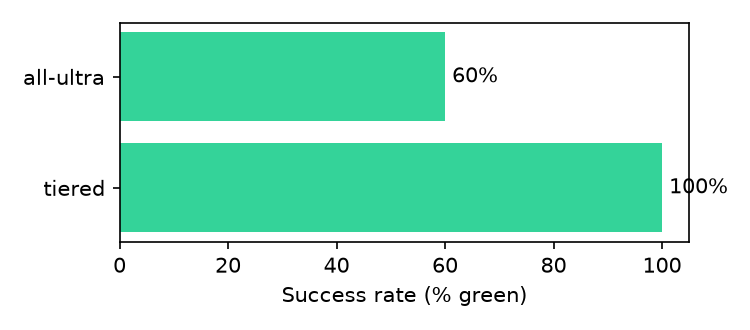
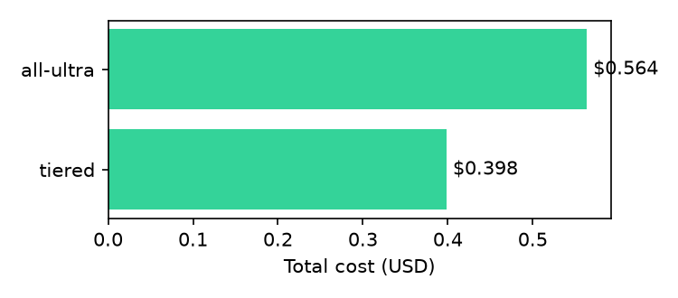

# Benchmark results

Generated by `benchmarks/plot.py` from `benchmarks/results/*.json`. Every number comes from a stored real
run; run IDs link to the full event log in the web app (`/runs/<id>`).

## Tiered vs all-Ultra routing

Tiered routing cost **29% less** than all-Ultra ($0.398 vs $0.564) with 5/5 vs 3/5 green.

**Not like-for-like:** these two runs used different code (tiered `c4c5a5c`, all-Ultra `31a137e`).

tiered: integrate.api.nvidia.com (cost = Token Factory list price, not billed); models nano `nvidia/nemotron-3.5-lightning-30b-a3b`, super `nvidia/nemotron-3.5-super-vl-120b-a12b`, ultra `nvidia/nemotron-3-ultra-550b-a55b`

all-ultra: integrate.api.nvidia.com (cost = Token Factory list price, not billed); models nano `nvidia/nemotron-3.5-lightning-30b-a3b`, super `nvidia/nemotron-3.5-super-vl-120b-a12b`, ultra `nvidia/nemotron-3-ultra-550b-a55b`

Each mode was run once per code version, and results vary between runs of the same code (see All benchmark runs), so treat single-run differences as indicative only.

## Routing: all-ultra (`20261027-234520-all-ultra`)

- **3/5 green** (0 partial, 2 failed)
- Tests fixed: 27/37
- Median verified change coverage: 100.0%
- Median characterization pass rate: 100%
- Median time: 475.0s · median cost: $0.0925 · total cost: $0.56372 · escalations: 14

| Repo | Kind | Upgrade | Status | Tests fixed | Behavior kept | Coverage | Cost | Time | Recipe | Run |
|---|---|---|---|---|---|---|---|---|---|---|
| pydantic_app | fixture | pydantic 1.10.18 → 2.14.1 | green | 11/11 | 100% | 91.3% | $0.0927 | 291s | reused | `fe7b71b123` |
| pydantic_inventory | fixture | pydantic 1.10.18 → 2.14.1 | failed (APITimeoutError) | 0/3 | — | — | $0.0839 | 1242s | reused | `b535398c89` |
| pydantic_orders | fixture | pydantic 1.10.18 → 2.14.1 | green | 9/9 | — | 100.0% | $0.2156 | 1016s | reused | `4d29297ddb` |
| openai_app | fixture | openai 0.28.1 → 1.109.1 | green | 7/7 | 100% | 100.0% | $0.0790 | 464s | reused | `138333ef67` |
| openai_moderator | fixture | openai 0.28.1 → 1.109.1 | failed \* | 0/7 | 3% | 100.0% | $0.0925 | 475s | reused | `845a186259` |

\* `845a186259`: relabelled partial -> failed: 0 repo tests fixed (status logic counted a passing generated behavior test as progress; fixed 2026-10-28)

## Routing: tiered (`20261027-231746-tiered`)

- **5/5 green** (0 partial, 0 failed)
- Tests fixed: 37/37
- Median verified change coverage: 100.0%
- Median characterization pass rate: 100%
- Median time: 317.0s · median cost: $0.0727 · total cost: $0.398478 · escalations: 25

| Repo | Kind | Upgrade | Status | Tests fixed | Behavior kept | Coverage | Cost | Time | Recipe | Run |
|---|---|---|---|---|---|---|---|---|---|---|
| pydantic_app | fixture | pydantic 1.10.18 → 2.14.1 | green | 11/11 | 100% | 91.7% | $0.0727 | 317s | reused | `025f8d4383` |
| pydantic_inventory | fixture | pydantic 1.10.18 → 2.14.1 | green | 3/3 | 100% | 100.0% | $0.0579 | 287s | reused | `1726f484aa` |
| pydantic_orders | fixture | pydantic 1.10.18 → 2.14.1 | green | 9/9 | — | 100.0% | $0.0931 | 813s | reused | `229dbd5fa2` |
| openai_app | fixture | openai 0.28.1 → 1.109.1 | green | 7/7 | 100% | 100.0% | $0.1276 | 1332s | reused | `f00cf11a41` |
| openai_moderator | fixture | openai 0.28.1 → 1.109.1 | green | 7/7 | 100% | 100.0% | $0.0473 | 273s | reused | `c630b76f53` |

## All benchmark runs

| Benchmark | Routing | Code | Provider | Green | Partial | Failed | Tests fixed | Total cost | Median time |
|---|---|---|---|---|---|---|---|---|---|
| `20261027-234520-all-ultra` | all-ultra | 31a137e | integrate.api.nvidia.com (cost = Token Factory list price, not billed) | 3 | 0 | 2 | 27/37 | $0.564 | 475.0s |
| `20261027-231746-tiered` | tiered | c4c5a5c | integrate.api.nvidia.com (cost = Token Factory list price, not billed) | 5 | 0 | 0 | 37/37 | $0.398 | 317.0s |
| `20261027-175218-tiered` | tiered | 32b8f7f | Token Factory | 3 | 1 | 1 | 29/37 | $0.510 | 134.0s |
| `20261027-173406-tiered` | tiered | 67a9c8e+dirty | Token Factory | 3 | 2 | 0 | 30/37 | $0.672 | 286.0s |
| `20261027-170459-tiered` | tiered | 588636c+dirty | Token Factory | 5 | 0 | 0 | 37/37 | $0.556 | 339.0s |
| `20261027-165705-all-ultra` | all-ultra | 588636c+dirty | Token Factory | 5 | 0 | 0 | 37/37 | $0.707 | 120.0s |
| `20261027-164204-tiered` | tiered | ee41e62+dirty | Token Factory | 3 | 2 | 0 | 29/37 | $0.682 | 264.0s |
